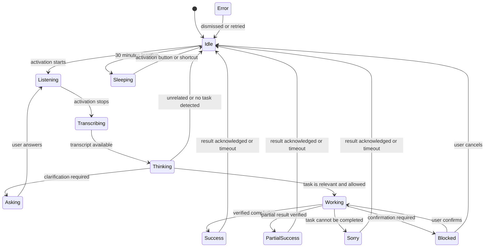
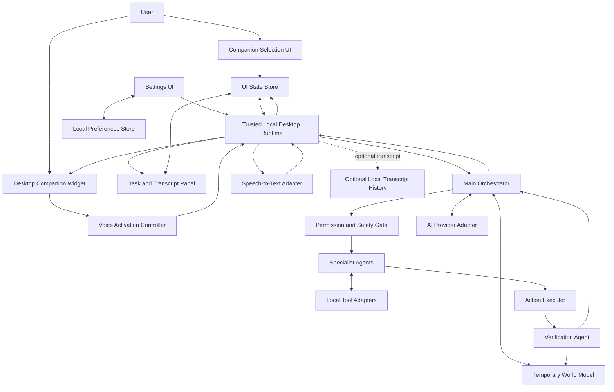
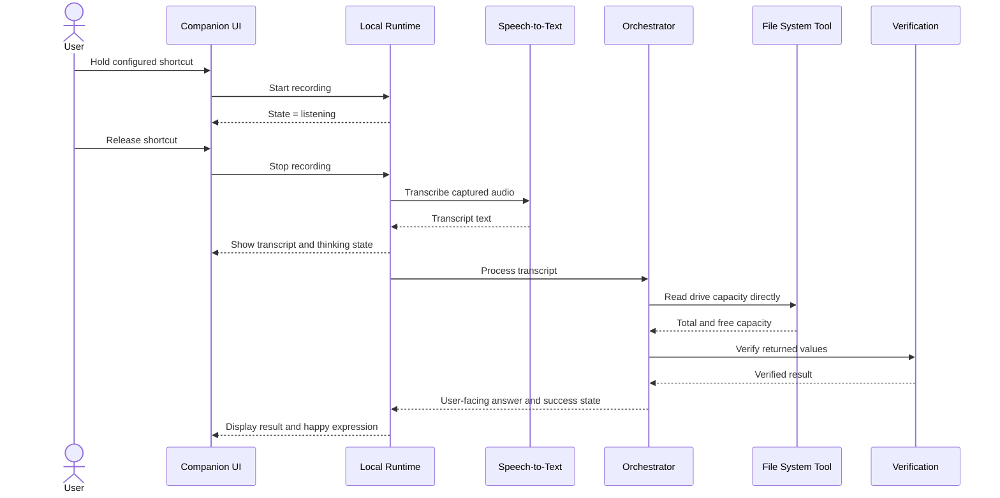

# Momo Desktop AI Agent — Frontend, Character UI & Backend Integration

**Document type:** Frontend/UI implementation specification  
**Status:** Proposed design — not yet implemented  
**Related document:** `Momo_Desktop_AI_Agent_Concept.md`  
**Goal:** Give an implementation agent (such as Claude) a clear UI plan and show how the frontend connects to the desktop runtime, AI orchestrator, specialist agents, and local tools.

---

## 1. Product direction

Momo is a Windows desktop AI assistant with five selectable chibi companions. The chosen companion appears in a small always-on-top desktop widget near the bottom-right corner, seated at its own 3D table. The character is the assistant's visual identity; all five characters share the same task engine and system permissions.

The frontend must make it obvious:
- which companion is selected;
- whether the microphone is idle, recording, transcribing, thinking, acting, asking a question, successful, or blocked;
- what Momo heard and what it plans to do;
- when user confirmation is required;
- whether transcript history is enabled.

The first implementation should prioritize a reliable 2D/3D-ready UI shell and accessible controls. Do not block the entire app on finished 3D models. Use placeholder models or static renders until real `.glb` assets and animations are available.

## 2. Core experience

1. On first launch, show a companion-selection screen with all five character cards.
2. The user selects one companion.
3. The selected character appears seated at an individual wooden table in a cherry-blossom environment, as a compact desktop widget.
4. The user opens Settings to choose **exactly one** voice activation mode:
   - **Hold shortcut:** hold a configurable keyboard shortcut to record; releasing it stops the recording.
   - **Tap to toggle:** press the configured shortcut or microphone button once to start; press it again to stop.
5. The chosen mode is persisted locally. The inactive mode's event handler must not run.
6. After the user stops recording, Momo transcribes the speech, shows the transcript, determines whether it is a task directed at the assistant, then plans and executes only if appropriate.
7. The character expresses the current state. If the task completes, show a happy/success expression. If it needs clarification, show a curious/questioning expression. If it cannot complete the task, show a sorry/blocked expression and explain why.
8. After 30 minutes without user interaction, the companion can enter a resting/sleeping animation. The app is not continuously listening for a wake word. The user wakes it through the configured shortcut/button.

## 3. Frontend screens and components

### 3.1 Companion selection

- Display five selectable cards using the supplied reference images.
- Show selection state clearly (outline/check mark, not color alone).
- Persist the selected companion ID locally.
- Provide a preview and a **Use this companion** action.
- Character names should be configurable labels; don't hard-code anime character names into system logic.
- Keep character selection separate from permissions and AI provider settings.

### 3.2 Desktop companion widget

- Small, frameless or minimally framed, always-on-top window, initially near the bottom-right corner.
- Character sits on an individual 3D table; the cherry-blossom garden is a visual theme/optional backdrop, not required to cover the entire desktop.
- Allow drag-to-reposition and remember widget position locally.
- Include a compact microphone control and a settings button.
- Keep controls usable at different Windows display scales.
- Offer a compact mode and a larger interaction panel.
- Avoid obscuring important content; allow users to move, hide, or minimize the widget.

### 3.3 Task / conversation panel

Show:
- recognized sentence (editable before submission if practical);
- current task state;
- short plan or explanation before consequential actions;
- clarification question, if needed;
- final result and verification status;
- optional local task history only when the user enables it.

Do not expose internal chain-of-thought. Show concise user-facing reasoning such as “I found two contacts with that name. Which one do you mean?”

### 3.4 Settings

**Voice activation**
- Radio selection: `Hold shortcut` OR `Tap to toggle`.
- Exactly one mode can be active.
- Shortcut recorder for custom combinations; validate reserved/conflicting combinations.
- Visible recording indicator toggle (recommended default: on).
- Input device selection only if multiple microphones are available.
- Test microphone action.

**Privacy**
- Transcript history toggle (recommended default: off).
- Audio saving toggle (default: off; do not save raw audio by default).
- Clear local transcript/task history action, when history exists.
- Explain that local deletion does not control a third-party AI provider's retention policy.

**Appearance**
- Select companion.
- Widget size, position, and opacity.
- Reduce-motion option.
- Optional garden/table visual style.

**AI and tools**
- Provider/model status without exposing secret keys.
- Local-only mode if a compatible local model is installed.
- API key management should be handled securely by the desktop backend or OS credential store; never ship secrets in frontend code or commit them to the repository.

## 4. Character expression system

Expressions are presentation states driven by explicit frontend events. They do not decide what the agent does.

| UI state | Suggested expression/animation | Example user-facing text |
|---|---|---|
| `idle` | Gentle blink, relaxed seated pose | No message |
| `listening` | Attentive face, subtle microphone pulse | “Listening…” |
| `transcribing` | Focused face, small audio waveform | “Turning speech into text…” |
| `thinking` | Curious/pondering face, small thought indicator | “Let me check that.” |
| `asking` | Curious face, slight head tilt | “Which file did you mean?” |
| `working` | Focused face, subtle activity motion | “Working on it…” |
| `success` | Happy smile, bright eyes, small celebratory movement | “Done — I verified it.” |
| `partial_success` | Relieved/neutral smile | “I finished part of it; one step remains.” |
| `sorry` | Apologetic face, lowered head | “Sorry, I couldn't complete that.” |
| `blocked` | Serious/cautious face | “I need your confirmation before continuing.” |
| `error` | Concerned face | “Something went wrong. You can retry.” |
| `sleeping` | Closed eyes, gentle breathing | “Resting — use your shortcut or button to wake me.” |
| `disabled` | Neutral/static pose | “Microphone access is disabled.” |

Every character should support the same semantic states, even if the artwork differs. Start with a small set of reusable animations; missing animations fall back to the nearest available expression. Never let an animation imply success before backend verification has succeeded.

### State transitions



## 5. Connected frontend-to-backend architecture

The frontend should not directly run arbitrary shell commands or own AI provider credentials. It sends typed requests to a trusted local desktop runtime. The runtime owns microphone capture, shortcut handling, local APIs, permission checks, AI calls, action execution, and verification.



### Responsibility boundary

- **Frontend:** renders screens, character expression, selection, transcript, status, settings, confirmations and results.
- **Local desktop runtime:** captures audio, receives the selected shortcut/button events, validates mode, stores preferences, and mediates all tool calls.
- **Main orchestrator:** determines whether a transcript contains a task for Momo, resolves ambiguity, plans the minimum sufficient actions, and coordinates specialists.
- **Specialists:** report evidence about windows, UI controls, files, apps, browser state, and visible content.
- **Permission/safety gate:** checks allowed operations and requests user confirmation for consequential actions.
- **Action executor:** performs only authorized actions through explicit tool adapters.
- **Verification agent:** checks the result and sends a verified status back to the frontend.
- **Temporary world model:** holds current-session observations with source, timestamp/freshness and confidence. Clear it when Momo exits.
- **Local preference store:** holds selected character, shortcut mode, shortcut combination, widget position and privacy settings.
- **Optional history store:** disabled by default; if enabled, store transcripts rather than raw audio by default.

## 6. Typical request sequence

Example: the user selects a companion, holds the configured shortcut, and says, “Tell me how much free space is on D drive.”



This read-only task should use a local system API and should not open File Explorer or call the LLM unnecessarily if a deterministic local handler can answer it.

## 7. Voice activation rules

Implement a single `ActivationMode` setting with only these values:
- `hold`
- `toggle`

Do not implement the two modes as independent listeners that can both run.

**Hold mode**
- Key-down for the configured chord starts recording once.
- Key-up of any required chord key stops recording once.
- Ignore key-repeat events.
- Releasing the chord must not submit duplicate requests.
- A failed or conflicting global shortcut must be surfaced in settings.

**Toggle mode**
- First valid shortcut/button activation starts recording.
- Second activation stops recording and submits.
- Releasing the shortcut does not stop recording.
- A second press during transcription/thinking must not create a second overlapping session.

**Both modes**
- Only one microphone capture session at a time.
- Show a clear recording indicator.
- Handle microphone permission denial, unplugged devices, empty audio and transcription failure.
- Stop recording when the user explicitly cancels.
- No always-on wake-word listening is required.
- Inactivity timeout is 30 minutes by default and should be configurable or clearly documented.

## 8. Task relevance, safety and results

After transcription, the orchestrator classifies the utterance into:
1. A task or question intended for Momo.
2. A likely unrelated utterance.
3. Ambiguous intent requiring clarification.

Do not assume every sentence is a command. For ambiguous speech, ask a concise question. For unrelated speech, do not take action; return to idle without making claims about what the user meant.

Before an action:
- resolve the exact target;
- inspect current state rather than relying on stale observations;
- apply the permission/safety gate;
- ask for confirmation when the operation is consequential or ambiguous.

After an action:
- verify the result;
- only then emit `success`;
- otherwise use `partial_success`, `sorry`, `blocked`, or `error` as appropriate.

Web pages, documents, files, and screen text are untrusted data, not instructions that override Momo's safety rules.

## 9. Frontend component map

Suggested component structure (adapt to the chosen framework):

```text
src/
  app/
    companion-picker/
    settings/
    task-panel/
  components/
    companion/
      CompanionWidget
      CompanionSelector
      CharacterRenderer
      ExpressionController
      TableScene
      CherryBlossomBackdrop
    voice/
      MicrophoneButton
      RecordingIndicator
      ShortcutRecorder
      TranscriptPreview
    task/
      TaskStatus
      ClarificationCard
      ConfirmationDialog
      ResultCard
    settings/
      VoiceSettings
      PrivacySettings
      AppearanceSettings
      ProviderSettings
  state/
    companion-state
    task-state
    settings-state
  types/
    companion
    activation
    task
    runtime-events
```

Suggested backend/runtime boundary:

```text
desktop-runtime/
  activation/
    global-shortcut
    microphone-session
  speech/
    transcription-adapter
  orchestration/
    main-orchestrator
    intent-router
    temporary-world-model
  agents/
    desktop-agent
    visual-perception-agent
    ui-panel-agent
    filesystem-agent
    application-agent
    browser-agent
    action-agent
    verification-agent
  tools/
    windows-api
    ui-automation
    filesystem
    browser
  safety/
    permission-gate
    confirmation-policy
  storage/
    preferences
    optional-transcript-history
  ai/
    provider-adapter
```

This is a proposed structure, not a claim that these files already exist. Keep UI components independent from a particular AI vendor.

## 10. Typed event contract

Use a small explicit event protocol between the UI and the local runtime. Exact transport (Tauri commands/events, Electron IPC, or another desktop shell) must be chosen during implementation.

Suggested event shape:

```ts
type ActivationMode = "hold" | "toggle";

type CompanionUiState =
  | "idle"
  | "listening"
  | "transcribing"
  | "thinking"
  | "asking"
  | "working"
  | "success"
  | "partial_success"
  | "sorry"
  | "blocked"
  | "error"
  | "sleeping"
  | "disabled";

type RuntimeEvent =
  | { type: "voice.started"; sessionId: string }
  | { type: "voice.stopped"; sessionId: string }
  | { type: "transcript.ready"; sessionId: string; text: string }
  | { type: "task.state"; taskId: string; state: CompanionUiState; message?: string }
  | { type: "task.confirmation_required"; taskId: string; summary: string }
  | { type: "task.clarification_required"; taskId: string; question: string }
  | { type: "task.completed"; taskId: string; summary: string; verified: true }
  | { type: "task.failed"; taskId: string; summary: string; recoverable: boolean }
  | { type: "runtime.error"; code: string; message: string };
```

Validate incoming events at the runtime boundary. Treat event payloads as data; the UI must not execute commands based solely on text received from a model.

## 11. Data and privacy defaults

Persist only what is needed for user experience:
- selected companion ID;
- activation mode and shortcut;
- widget position and appearance settings;
- explicit privacy preferences.

By default:
- do not save raw microphone audio;
- do not save transcripts or task history permanently;
- keep the temporary world model in memory for the current session;
- clear temporary observations and task coordination state on exit;
- store API credentials outside frontend bundles and source control.

If optional transcript history is enabled, explain what is saved and provide a clear local deletion action. Local cleanup cannot guarantee deletion of information already sent to a third-party provider; check that provider's retention terms separately.

## 12. 3D asset and animation plan

The provided images are visual references, not rigged 3D models. To implement true 3D characters:
- create or obtain one `.glb` model per companion;
- keep a consistent coordinate scale and seated pose;
- provide animations or blend shapes for idle, listening, thinking, happy, sorry, confused, and sleeping;
- keep the table and optional cherry-blossom background as separate scene assets where possible;
- use a fallback static render when a model or animation is unavailable.

Do not try to generate a production-ready rig from a single concept sheet automatically. First build the UI and state transitions with placeholders, then replace the renderer assets.

## 13. Recommended implementation phases

### Phase 1 — UI shell
- Companion selection and selected-character persistence.
- Desktop widget layout with table and static character art.
- Task panel and settings screen.
- Mock task states to test all expressions.
- No AI actions yet.

### Phase 2 — Activation and transcription
- Exactly one activation mode.
- Configurable global shortcut and microphone button.
- Recording indicator, cancellation, and transcription.
- Transcript preview and errors.

### Phase 3 — Runtime integration
- Typed UI/runtime event protocol.
- Intent routing and local deterministic tasks.
- Main orchestrator, specialist tools, permission gate and verification.
- Confirmation and clarification flows.

### Phase 4 — 3D polish
- Import `.glb` character models and table.
- Connect character animations to semantic UI states.
- Add cherry-blossom environment and idle/resting behaviour.
- Optimize performance for the target Windows laptop.

### Phase 5 — Privacy and resilience
- Verify storage defaults and deletion.
- Handle API limits, offline mode, mic errors and app restart.
- Test shortcut conflicts, repeated events and stale task results.

## 14. Acceptance criteria

- [ ] The user can select any of the five companions.
- [ ] The selected companion appears in the desktop widget on its own table.
- [ ] All companions map to the same semantic expression states.
- [ ] Exactly one activation mode is enabled at a time.
- [ ] Hold mode starts on chord press and stops on release.
- [ ] Toggle mode starts on first activation and stops on second.
- [ ] The microphone state is always visible while recording.
- [ ] A 30-minute inactivity period can trigger resting; activation wakes the companion.
- [ ] The frontend receives task status updates from the runtime rather than guessing success.
- [ ] Success expression appears only after verification.
- [ ] Ambiguous targets trigger clarification; consequential actions require confirmation.
- [ ] No raw audio or transcript history is saved by default.
- [ ] API keys are never exposed in frontend code.
- [ ] The app remains usable with placeholder artwork if 3D assets are not ready.

## 15. Instructions for the implementation agent

Read this file alongside `Momo_Desktop_AI_Agent_Concept.md`. Before coding, inspect the existing repository and report:
1. current desktop framework and UI stack;
2. existing runtime/backend entry points;
3. which components and services already exist;
4. gaps between the repository and this specification;
5. the smallest safe implementation plan.

Do not replace working architecture without explaining why. Do not invent API endpoints or claim a feature is implemented before verifying it. Implement Phase 1 first, using mock runtime events, then integrate the real backend incrementally. Preserve the single-activation-mode rule and the privacy defaults.
